# Learning objects in the database: a guided tour

This is a gentle tour of how the server stores **what students learn**:
books, chapters, word senses, grammar patterns, and the drafts that turn
into them. I provides a correlation between the backend and the frontend TypeScript
types and JSON.

The schemas themselves are in
[`server/src/persistence/models.ts`](../../server/src/persistence/models.ts).
For the reasoning behind them, see the design docs at the end.

---

## 1. Five ideas before we start

### MongoDB words, frontend words

This app uses **MongoDB** with **Mongoose**.
Mongo is a NoSQL database without tables and rows.
It has *collections* of *documents*, and a document is just a JSON object.

| Mongo word | Think of it as | Example here |
| --- | --- | --- |
| collection | a table, or an array you keep on the server | `books` |
| document | one row: a JSON object | one book |
| field | a property on that object | `title` |
| schema (Mongoose) | a TypeScript type that is checked when saving | `bookSchema` |
| `_id` | an id Mongo adds to every document (an `ObjectId`) | `6650f0…a1` |
| `ref: 'User'` | "this field holds another document's `_id`" | `ownerUserId` |
| index | a lookup table that makes a query fast | `{ slug: 1 }` |
| unique index | "no two documents may have the same value here" | one book per slug |
| subdocument | a nested object inside a document | `language: { target, native }` |

Two things surprise SQL people, and they might surprise you too:

- **A `ref` is not enforced.** It works like storing a React `key`: nothing
  stops it pointing at something that was deleted. Our code is careful
  about this, and several things are **never deleted** for exactly this
  reason (see idea 4).
- **Not everything is in Mongo.** Some content lives in JSON files committed
  to the repo, and student progress lives in a separate service, the LRS
  (idea 3).

### Idea 1: a learning object is "one thing a student can know"

A **learning object** is the smallest thing we track. There are three
kinds:

| Kind | What it is | Id example |
| --- | --- | --- |
| `lexeme` | one word in one meaning | `ko/lexeme/시험/test` |
| `expression` | a phrase of several words in one meaning | `ko/expression/보여 주다/to-show` |
| `grammar-pattern` | one small grammar pattern | `ko/grammar-pattern/a-eo-jida/become` |

A lexeme is a basic unit of meaning in a language that covers an underlying word or set of related inflected forms.

Every id has four parts, `language/kind/word/meaning`, like a URL path.
They're plain strings, **not** Mongo `_id`s. That matters, because these
ids leave our database and go into learning records (idea 3).

A word with two meanings gives two learning objects:

1. `배` (boat) = `ko/lexeme/배/boat`
2. `배` (pear) = `ko/lexeme/배/pear`

### Idea 2: a book says *where* something was taught, not *what* it is

Learning objects belong to a **language**, not to a book. If two books both
teach `시험` meaning "test", there is one learning object, and progress made
in either book counts toward it.

A book records **where** it taught something, using a `sourceRef`:

```
ch27/vocabulary/1      → chapter 27, vocabulary entry 1
ch27/patterns/0        → chapter 27, grammar pattern 0
```

Add the book's slug in front and you get the *book-qualified* form:
`korean-language-book/ch27/vocabulary/1`.

### Idea 3: progress isn't in Mongo, it's in the LRS

When a student answers a question, the server sends **xAPI statements** to
an **LRS** (Learning Record Store, an external service). A statement is
roughly "Player 7F3A answered a question about `ko/lexeme/시험/test`, on
`reading`, correctly, at 09:00". It names the learning object and the
`sourceRef`.

A student's level for each learning object (their **Leitner track**) is
worked out by reading those statements back. So Mongo stores the
*content*, and the LRS stores the *history*.

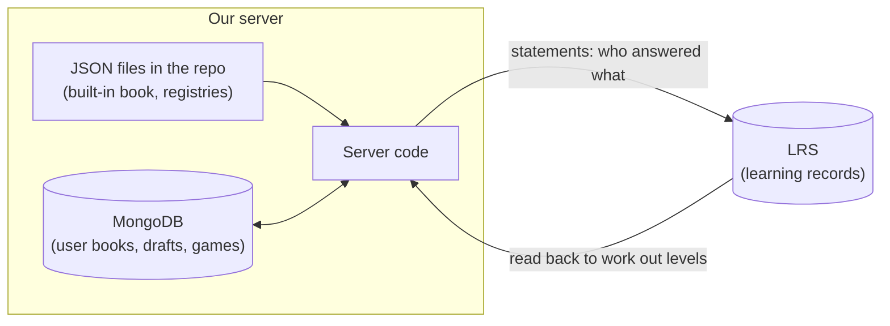

### Idea 4: some things are permanent

Once a statement naming `ko/lexeme/토끼/rabbit` has gone to the LRS, that
id can't change. If it did, the student's history would point at nothing.
That's why you'll see these rules again and again:

- Learning-object ids are never renamed or deleted.
- A published chapter's words keep their position and meaning (rule **G8**
  in the design docs). You can fix a typo in a gloss or add words at the
  end, but you can't reorder or remove them, because `ch1/vocabulary/3`
  must always mean the same entry.
- Book slugs never change.
- Chapters are *archived* (hidden), never deleted.

### Idea 5: files first, database second

The built-in textbook and its registries are **JSON files committed to
git**. Users' own books are in **Mongo**. The server merges the two, so the
rest of the code doesn't care where something came from. On a clash, **the
file wins**.

| Layer | Where | Who writes it |
| --- | --- | --- |
| The built-in book (`korean-language-book`) | `server/src/games/content/chapter26Data.json` … `chapter30Data.json` | us, in git |
| The sense registry for the built-in book | `server/src/games/content/ko-senses.json` | us, in git |
| The pattern registry for the built-in book | `server/src/games/content/ko-patterns.json` | us, in git |
| User books, their chapters, their new senses and patterns | Mongo: `books`, `chapters`, `senses`, `patterns` | users, by publishing |

---

## 2. The big picture

Here are the collections this tour covers and how they point at each
other. Don't try to memorise it. We'll go through it piece by piece.

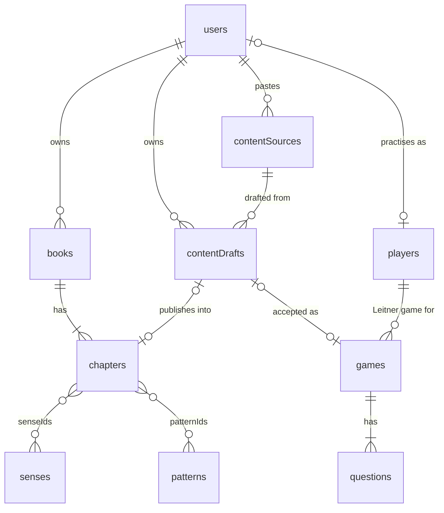

How to read the lines (this is Mermaid's "crow's foot" notation):

| Symbol at a line's end | Means |
| --- | --- |
| `\|\|` | exactly one |
| `\|o` | zero or one |
| `}o` / `o{` | zero or more |
| `}\|` / `\|{` | one or more |

So `books ||--|{ chapters` reads as "a book has one or more chapters, and
each chapter belongs to exactly one book".

Notice that `chapters` → `senses` is *many to many*. A chapter teaches many
senses, and a sense (`시험/test`) can be taught by many chapters in many
books. That's idea 2 in diagram form.

---

## 3. Books and chapters

### `books`

A user's library book. The built-in book isn't in this collection: it's in
the files.

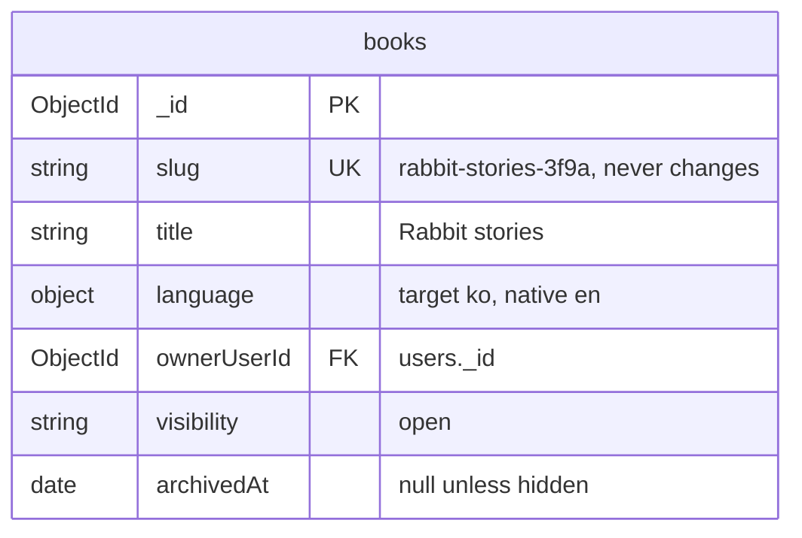

An example document:

```json
{
  "_id": "6650f00000000000000000b1",
  "slug": "rabbit-stories-3f9a",
  "title": "Rabbit stories",
  "language": { "target": "ko", "native": "en" },
  "ownerUserId": "000000000000000000000001",
  "visibility": "open",
  "archivedAt": null,
  "createdAt": "2026-11-22T09:00:00.000Z"
}
```

- `slug` has a **unique index**: no two books can share it. It ends in
  random hex (`-3f9a`) so two people can both have "Rabbit stories".
- The slug goes into learning records, so it never changes. That's also why
  it must never contain someone's name.

### `chapters`

One published chapter of a user book. This is the most interesting
collection, so let's take it slowly.

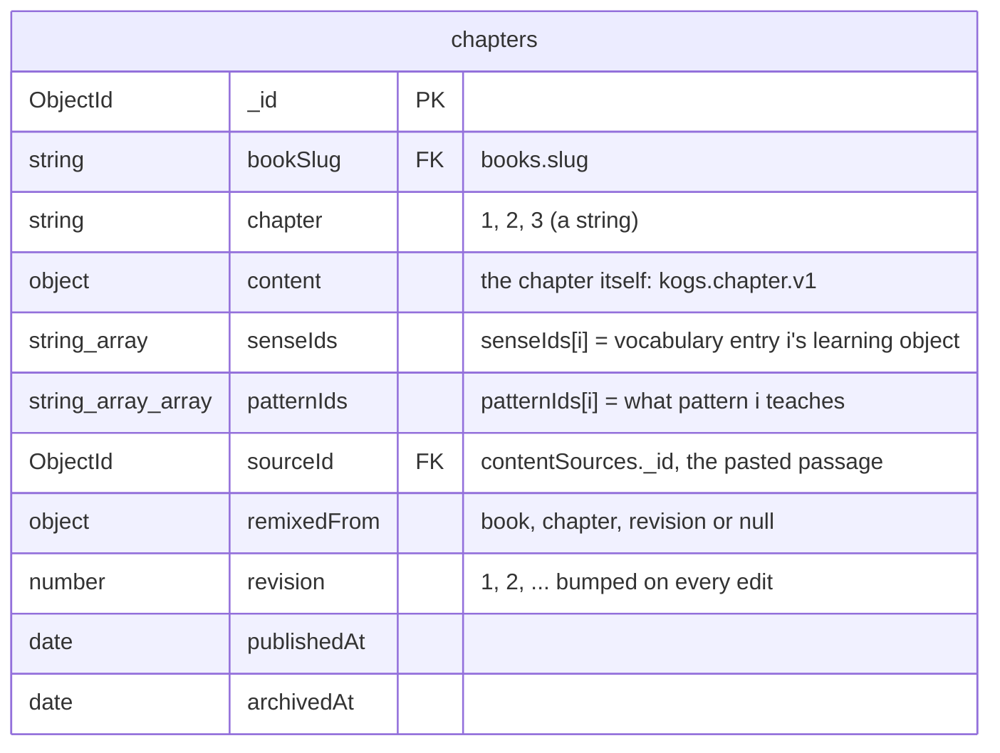

`(bookSlug, chapter)` together are unique: a book has one chapter 1.

**`content`** holds the chapter in the same shape as the built-in JSON files
(we call it `kogs.chapter.v1`), so YALLA reads both the same way:

```json
{
  "chapter": "1",
  "titleTarget": "토끼와 거북이",
  "titleNative": "The rabbit and the turtle",
  "dialog": [
    { "speakerNameTarget": "", "speakerNameNative": "",
      "speechTarget": "토끼와 거북이가 경주를 했어요.",
      "speechNative": "The rabbit and the turtle had a race." }
  ],
  "vocabulary": [
    { "id": 0, "targetLanguageText": "시험", "nativeLanguageText": "test, exam" },
    { "id": 1, "targetLanguageText": "토끼", "nativeLanguageText": "rabbit" }
  ],
  "patterns": [
    { "patternTarget": "VERB + -았/었어요", "patternNative": "did (polite past)",
      "exampleSentenceTarget": "토끼와 거북이가 경주를 했어요.", "...": "..." },
    { "patternTarget": "-(으)면", "patternNative": "if, when", "...": "..." }
  ]
}
```

**`senseIds` and `patternIds` are parallel arrays.** You've probably seen
this in frontend code: two arrays where index `i` in one goes with index
`i` in the other.

```json
"senseIds": [
  "ko/lexeme/시험/test",
  "ko/lexeme/토끼/rabbit"
],
"patternIds": [
  ["ko/grammar-pattern/at-eot-eoyo/did-polite"],
  ["ko/grammar-pattern/eu-myeon/if"]
]
```

- `content.vocabulary[1]` (토끼) teaches `senseIds[1]` (`ko/lexeme/토끼/rabbit`).
- `content.patterns[0]` teaches **every** id in `patternIds[0]`. It's an
  array of arrays because one book pattern can teach several grammar
  entries. `계속 더 ADJECTIVE + -아/어/여지네` teaches both "become"
  (`-아/어/여지다`) and "noticing" (`-네`).

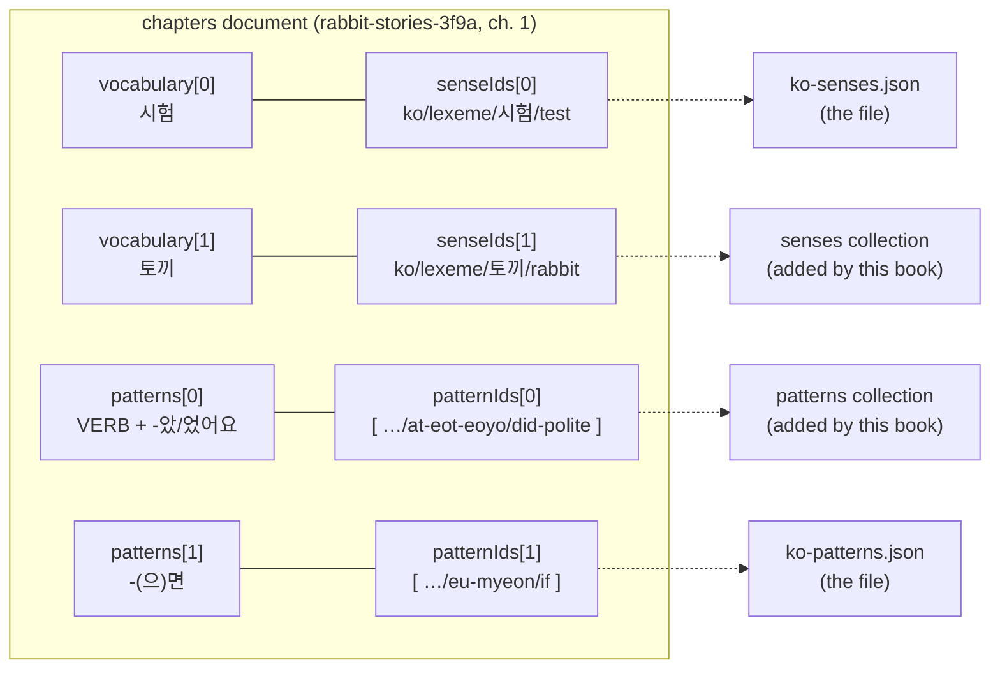

Why the parallel arrays matter: `ch1/vocabulary/1` (the `sourceRef`)
**is** index 1. If someone could reorder the vocabulary, `ch1/vocabulary/1`
would suddenly mean a different word, and the student's history in the LRS
would be wrong. That's why published vocabulary is frozen (idea 4).

**`revision`** is a simple guard against two edits at once. An edit says
"I started from revision 3". If the chapter is already at revision 4, the
save is refused. You might know this pattern as *optimistic locking*.

---

## 4. The registries: `senses` and `patterns`

A **registry** is the list of learning objects that exist for a language.
Before a chapter can be published, every word must point at a sense in the
registry and every pattern at one or more pattern entries. The registry
**is** the list of things students can make progress on.

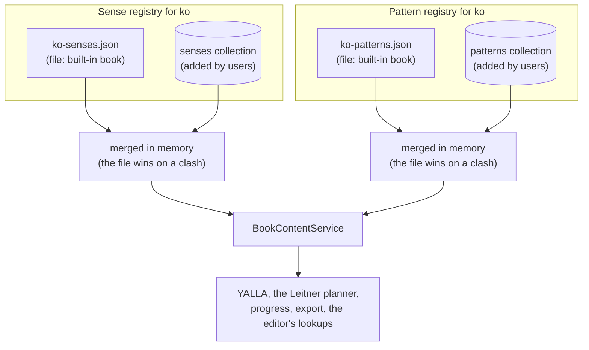

The merging happens in
[`book-content.service.ts`](../../server/src/learning/book-content.service.ts).
Its result is cached, and the cache is cleared whenever a chapter is
published.

### `senses`

Senses that users added when they published a chapter.

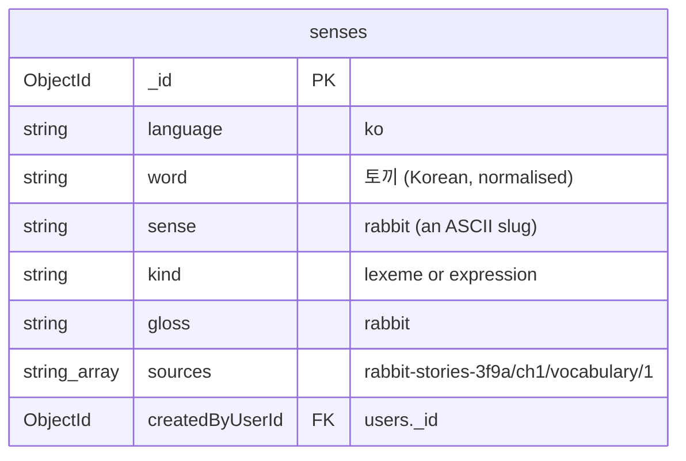

```json
{
  "language": "ko",
  "word": "토끼",
  "sense": "rabbit",
  "kind": "lexeme",
  "gloss": "rabbit",
  "sources": ["rabbit-stories-3f9a/ch1/vocabulary/1"]
}
```

- The learning-object id is built from the fields, not stored:
  `language/kind/word/sense` → `ko/lexeme/토끼/rabbit`.
- `(language, word, sense)` is unique, so two people can't both create
  `토끼/rabbit`. If that happens at the same moment, the second publish gets
  a "this sense was added meanwhile: reuse it" error.
- `sources` lists where it's taught. It's useful information, but the
  chapter's `senseIds` are what the app actually reads.

### `patterns`

Grammar patterns that users added. These work like senses, with a twist:
a pattern can be written many ways.

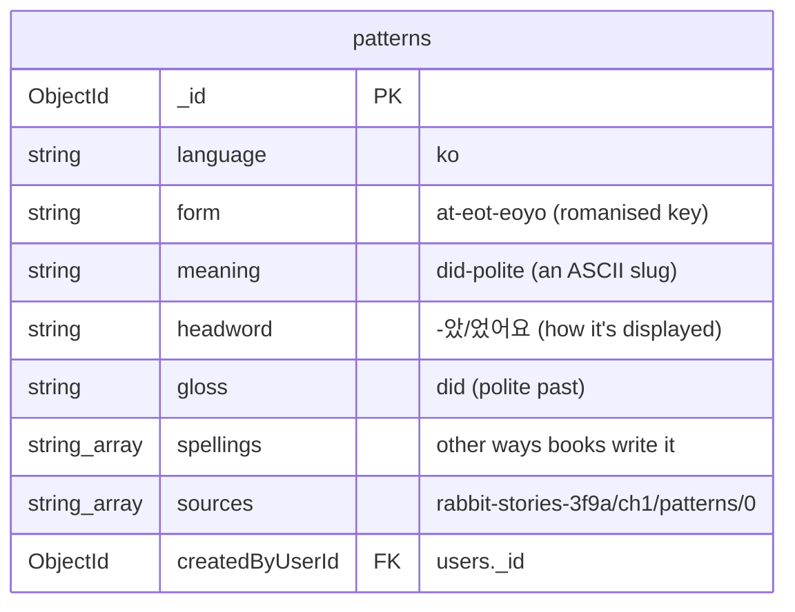

```json
{
  "language": "ko",
  "form": "at-eot-eoyo",
  "meaning": "did-polite",
  "headword": "-았/었어요",
  "gloss": "did (polite past)",
  "spellings": ["VERB + -았/었어요"],
  "sources": ["rabbit-stories-3f9a/ch1/patterns/0"]
}
```

**The twist: one pattern, many spellings.** Textbooks write the same
grammar as `-아/어/여지다`, `-어(아, 여) 지다`, `A-아/어지다` or
`~아/어 지다`. So nobody types a pattern's id. Instead the server:

1. reduces any spelling to a **matching key** (it drops `A-`, `VERB`, `+`,
   spaces, the implied `여`, and so on), then
2. romanises the key to get the id's `form`.

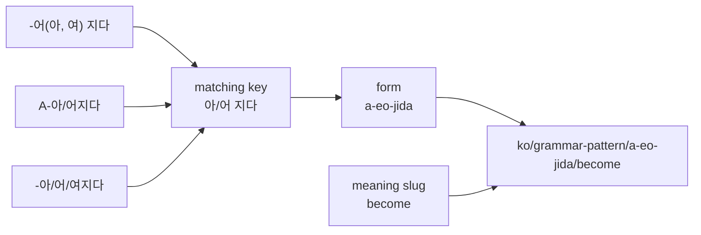

That's like a **pure function**: the same spelling always gives the same
id. The code is in
[`grammar-pattern.ts`](../../server/src/learning/grammar-pattern.ts)
(`patternKey`, `patternForm`).

- `(language, form, meaning)` is unique.
- `headword` and `gloss` are what people see. Strictly, only `form` and
  `meaning` are the id. The full rules are in
  [`../yalla/grammar-learning-objects.md`](../yalla/grammar-learning-objects.md).
- `spellings` grows when a chapter links a pattern to exactly one entry,
  so the next book that writes it the same way gets an exact match.

---

## 5. Drafts: how content gets in

Nothing the AI writes goes straight into a book. It becomes a **draft**
first, a person checks it, and only then is it published. (In the design
docs this is rule **G1**: the AI only ever drafts.)

### `contentSources`

The passage a user pasted. It's never edited: a changed paste is a new
source.

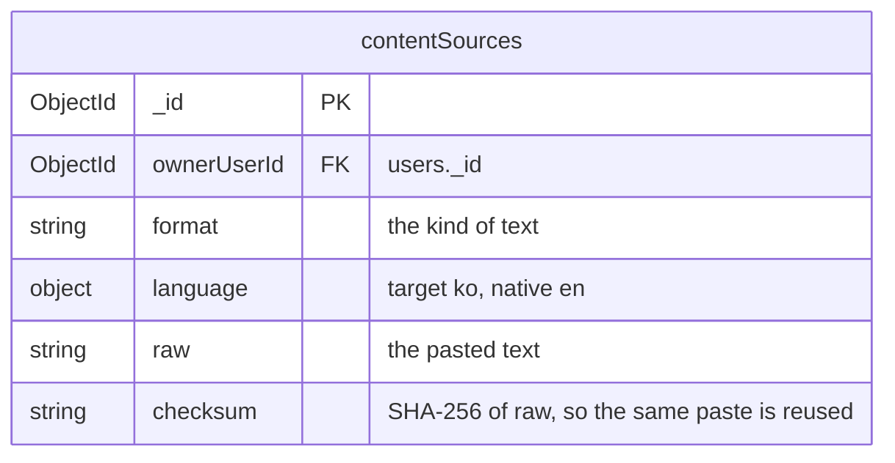

`(ownerUserId, checksum)` is unique. If you paste the same story twice, you
get the same source back. It's a bit like memoising by content.

### `contentDrafts`

One collection holds both kinds of draft: **game drafts** and **chapter
drafts**. `type` says which.

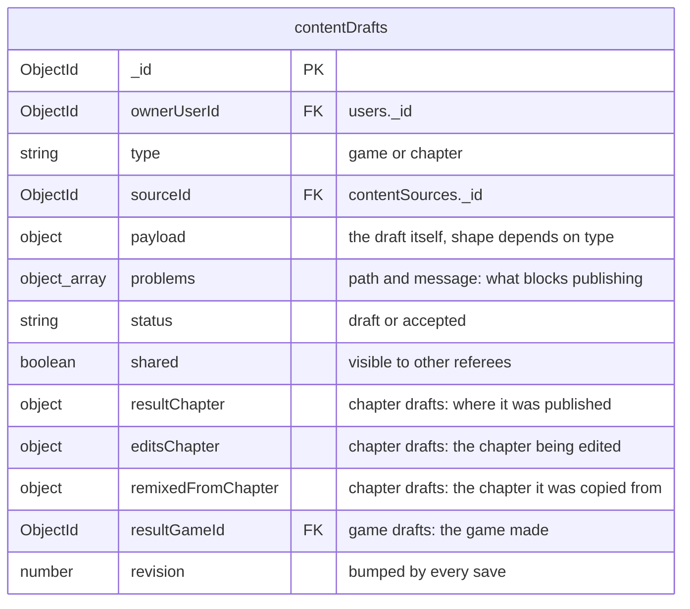

`payload` has the type `Mixed`, which means Mongo stores whatever JSON we
give it. The *server* checks the shape with **zod** (a schema library you
may know from forms) before saving. For a chapter draft it looks like the
chapter, plus a **decision** for every word and pattern:

```json
{
  "bookSlug": "",
  "newBook": { "title": "Rabbit stories", "slug": "rabbit-stories-3f9a" },
  "titleTarget": "토끼와 거북이",
  "vocabulary": [
    { "targetLanguageText": "시험", "nativeLanguageText": "test, exam",
      "sense": { "decision": "reuse", "reuseId": "ko/lexeme/시험/test" } },
    { "targetLanguageText": "토끼", "nativeLanguageText": "rabbit",
      "sense": { "decision": "new", "newSense": "rabbit", "kind": "lexeme", "confirmed": true } }
  ],
  "patterns": [
    { "patternTarget": "-(으)면", "patternNative": "if, when",
      "entries": [ { "decision": "reuse", "reuseId": "ko/grammar-pattern/eu-myeon/if" } ] }
  ]
}
```

Each decision is either:

- **reuse**: "this is a learning object that already exists" (its id), or
- **new**: "this is a new one", which the **user** must tick as confirmed.
  The AI can suggest a new one, but it can never confirm it.

`problems` is recalculated on every save. It's the list you see in red in
the editor, and Publish only works when it's empty.

### The life of a chapter draft

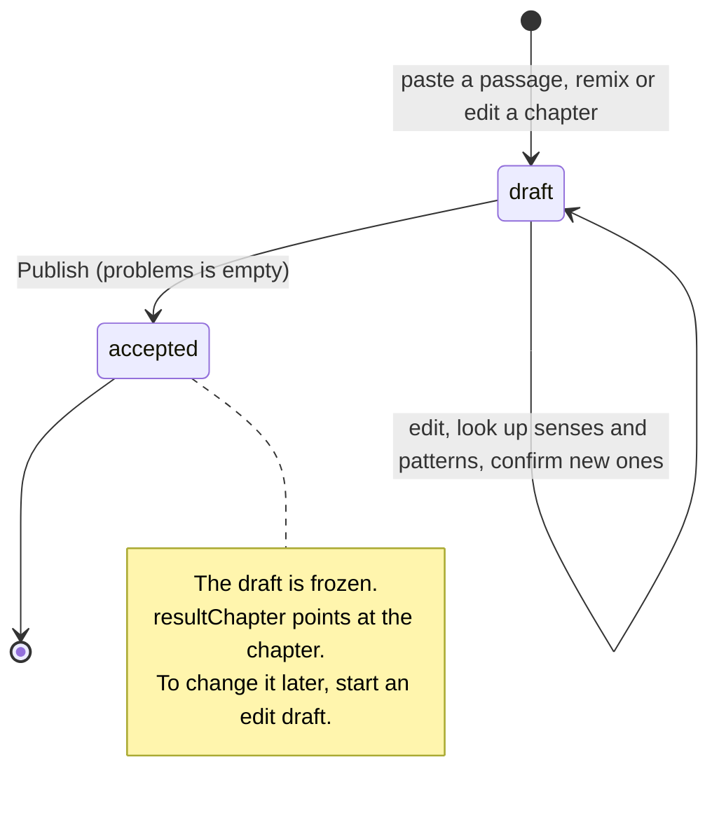

### What Publish writes

Publishing is one **transaction**: several writes that all succeed or all
fail together, like a single `setState` that updates several things at
once. Nobody ever sees half a chapter.

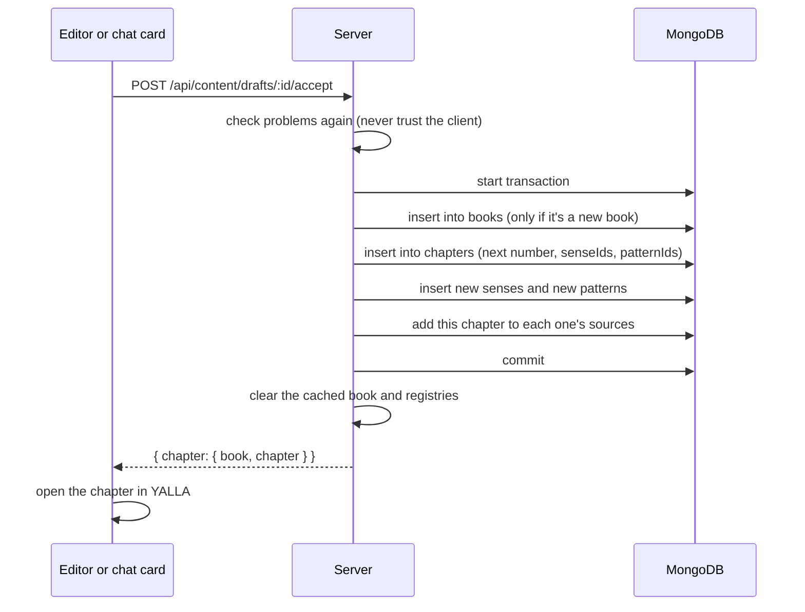

If someone else created the same new sense or pattern a second earlier,
the unique index refuses the insert, the whole transaction is rolled back,
and the user is told to reuse it instead.

---

## 6. Where learning objects show up in games

When a student plays, each question remembers which learning object it was
about. That's how an answer becomes a learning record.

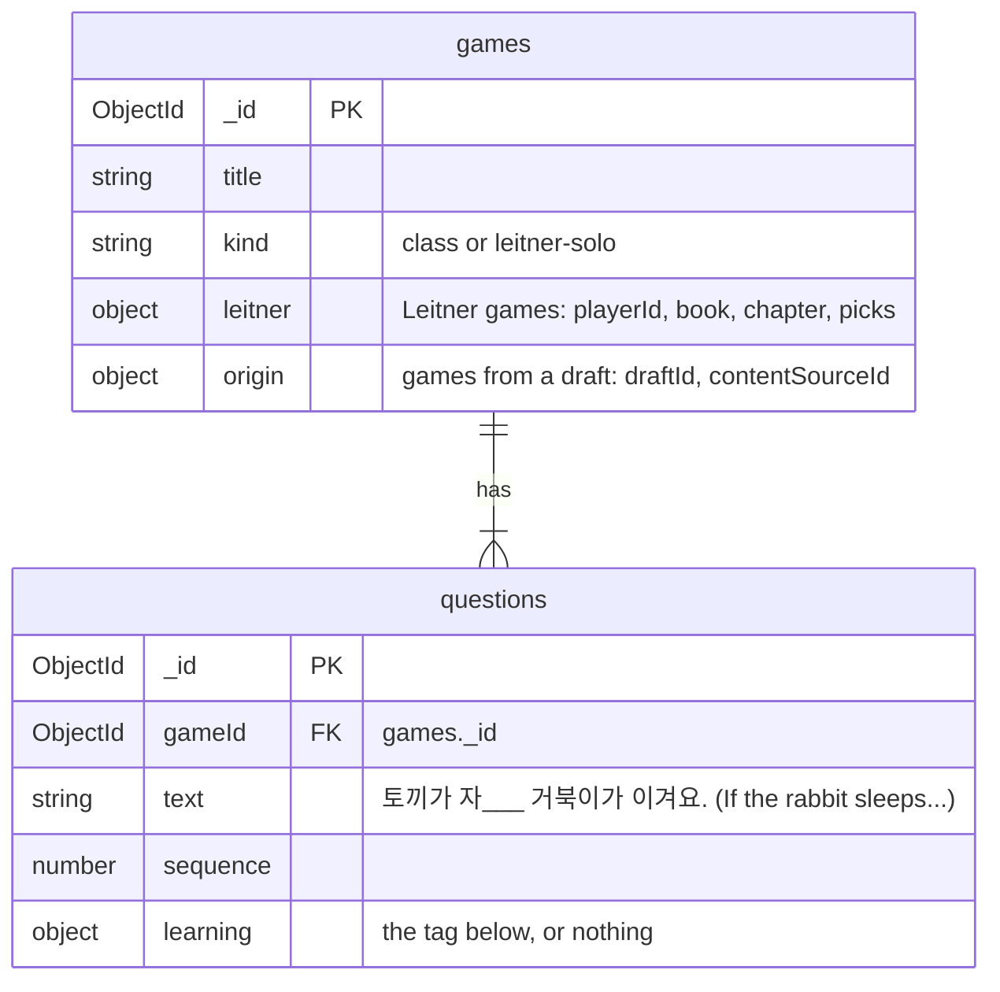

The `learning` tag on a question:

```json
{
  "learningObjectId": "ko/grammar-pattern/eu-myeon/if",
  "book": "rabbit-stories-3f9a",
  "sourceRef": "ch1/patterns/1",
  "aspect": "usage",
  "target": "-(으)면",
  "native": "if, when"
}
```

- **`aspect`** is *which skill*: `reading` (Korean → English), `writing`
  (English → Korean) for words, and `usage` (fill the ending into a
  sentence) for grammar patterns.
- One learning object plus one aspect makes one Leitner **track**: "Mia's
  *reading* of `시험/test`" is a different track from "Mia's *writing* of
  `시험/test`".

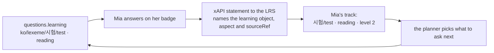

A word from a built-in chapter and the same word reused in a user's chapter
give the **same** track. Progress follows the learning object, not the book.

### Players and users

These two often get mixed up:

| | `players` | `users` |
| --- | --- | --- |
| Who | a student the referee plays with | someone who logs in (a referee) |
| Logs in? | never | yes |
| In learning records as | `externalId`, a random UUID | not at all |
| Personal data | a first name or nickname only | display name |

A user can practise in YALLA "as" a player (`users.playerId`), and then
their YALLA answers go onto that player's tracks.

---

## 7. Putting it together: one word's journey

Let's follow `토끼` (rabbit) from a paste to a student's level.

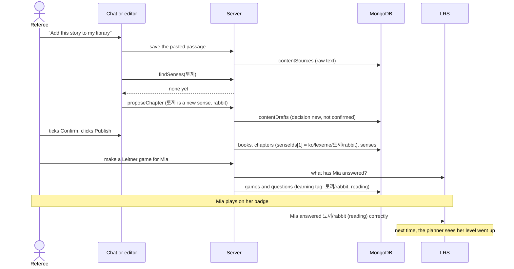

---

## 8. Cheat sheet

| I want to know… | Look at |
| --- | --- |
| which words a user chapter teaches | `chapters.content.vocabulary` + `chapters.senseIds` (same index) |
| which grammar a user chapter teaches | `chapters.content.patterns` + `chapters.patternIds` (same index) |
| which words the built-in book teaches | `ko-senses.json` (`sources` lists the chapter entries) |
| which grammar the built-in book teaches | `ko-patterns.json` (`sources`) |
| whether a sense or pattern already exists | `GET /api/senses?words=…`, `GET /api/patterns?spelling=…` |
| what's stopping a draft from publishing | `contentDrafts.problems` |
| what a question was testing | `questions.learning` |
| a student's level | not in Mongo: worked out from the LRS statements |

**Words you'll meet in the code and docs:**

| Term | Meaning |
| --- | --- |
| learning object | one word-meaning, phrase-meaning or grammar pattern; id `language/kind/word/meaning` |
| sense | a word in one meaning (a `lexeme` or `expression` learning object) |
| pattern entry | a grammar-pattern learning object in the pattern registry |
| book pattern | a pattern as one book writes it (`계속 더 ADJECTIVE + -아/어/여지네`); it teaches one or more pattern entries |
| registry | the list of learning objects for a language: file + collection |
| `sourceRef` | where in a book something was taught: `ch1/vocabulary/3` |
| aspect | which skill: `reading`, `writing`, `usage` |
| track | one student × one learning object × one aspect, with a Leitner level |
| LRS / xAPI | the external learning-record store and the statement format it uses |
| G1, G8, … | numbered decisions in the design docs below |

## Further reading

- [`../hashbrown/creating-games-with-hashbrown.md`](../hashbrown/creating-games-with-hashbrown.md):
  drafts, library chapters, and decisions G1–G15
- [`../yalla/grammar-learning-objects.md`](../yalla/grammar-learning-objects.md):
  grammar patterns, the matching key and the pattern registry
- [`../xAPI/learning-objects.md`](../xAPI/learning-objects.md): what a
  learning object is (decisions A1–A4)
- [`../xAPI/leitner-method.md`](../xAPI/leitner-method.md): tracks, levels
  and the sense registry
- [`../data-models.md`](../data-models.md): the game side (games,
  questions, guesses, badges)
