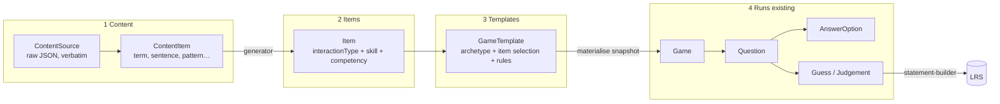

# Game creation — content, item types, archetypes and rules

Status: **planning**. No implementation yet. Nothing here is locked until
it moves to "Locked decisions".

Related:

- `[../data-models.md](../data-models.md)`: the existing `Game` /
`Question` / `AnswerOption` / `Guess` model this plan builds on
- `[../xAPI/xAPI.md](../xAPI/xAPI.md)` → "Canonical question model" and
"Use case walkthrough": the Korean-vocabulary pilot this plan targets
first
- `[../xAPI/xapi-export-plan.md](../xAPI/xapi-export-plan.md)` and
`[../xAPI/LRS.md](../xAPI/LRS.md)`: statement shape and the permanent
IRI/ID decisions this plan must not break
- `[../real-time-game/game-modes.md](../real-time-game/game-modes.md)`:
controller and badge topologies and the Zero button map (the physical
inputs a game can use)
- `language-learning-app/public/chapter26Data.json`: the first source
content
- `language-learning-app/src/utils/generateStudyListObjects.ts`: how that
app splits content into reading / writing / speaking / listening

---


## Why this plan exists

The badge and NFC-card prototype works end to end. A referee creates a
game, adds multiple-choice questions by hand (`POST /api/questions`),
players scan slot cards `A`–`E`, and a completed game exports to the LRS as
xAPI `answered` + `scored` statements
(`server/src/xapi/statement-builder.ts`).

To be useful in a classroom, teachers need to:

1. **Bring content once.** Load a textbook chapter, a word list or a Moodle
  question bank without retyping it per game.
2. **Turn content into many question types**, not only multiple choice.
  The common LMS types are true/false, gap fill (cloze), matching,
   ordering, short answer and observed performance.
3. **Pick a game shape** (an archetype such as a quiz, a speed round or a
  scavenger hunt) and **add rules** (scoring, time limits, teams,
   elimination) to make a new game without writing code.
4. **Test competence, not only recall.** Check whether a learner can use
  what they learned in a new situation, including out in the field with
   badges, controllers and targets.

The question this doc answers first is **how to store the content that
becomes games**. The rest of the plan follows from that answer.

## Decisions from review (2026-10-13)

- **Targets** are NFC tags fixed to places or objects in the room. Other
  sensors may become inputs for new question types later, so input
  resolution should not assume NFC forever (see "Card resolution" in
  Layer 4).
- **First games are multiple choice only**: reading and writing, four
  options, cards A–D. Each answer records **whether it was correct and how
  fast it was**. Listening and speaking (and so audio/TTS) are
  **deferred**.
- **Screens**: a browser shows the game in **view mode** for players to
  read questions. The referee has the **controller** (start the game, run
  the flow) and a **laptop** with the game in **edit mode** (open it for
  joining). The Zero LCD keeps its current job: choosing game mode and
  confirming in Mode 2 that badges are ready for the game and for each
  question.
- **Question generation**: start with a **cheap, rule-based generator**
  (see "Cheap generator"). Hashbrown/AI generation from a teacher's prompt
  comes later and produces the same `Item` shape.
- **No review step** for generated or AI-made questions yet. Deferred.
- **Competency framework**: our own codes for the pilot.

## Recommendation in one paragraph

Store content in **four layers** that change at different speeds. Each
layer only references the one below it:

1. **Content**: raw source material, kept verbatim, plus normalised
  `ContentItem`s (a word, a sentence, a pattern, a dialogue line).
2. **Items**: a question bank of reusable, versioned questions. Each item
  uses one **interaction type**, taken from the xAPI `cmi.interaction`
   list. It is generated from content items or written by hand.
3. **Game templates**: archetype + item selection + rules. This is what a
  teacher saves and reuses.
4. **Game runs**: today's `Game` / `Question` / `AnswerOption` / `Guess`
  rows. They are a frozen **snapshot** made when a template is played.

Pinning interaction types to the xAPI list means every new question type
already has a standard way to export. It also maps closely to QTI and to
Moodle's question types, so import and export later is a mapping, not a
redesign. Taking a snapshot at play time keeps exported statements stable
when a teacher edits the bank afterwards.



## Layer 1 — Content

### What the source looks like today

`chapter26Data.json` has:


| Section        | Shape                                                                                                | Count (ch. 26) | Becomes                                                                     |
| -------------- | ---------------------------------------------------------------------------------------------------- | -------------- | --------------------------------------------------------------------------- |
| `dialog[]`     | speaker + `speechTarget` / `speechNative`                                                            | 15             | `dialogLine` items: listening and role-play                                 |
| `vocabulary[]` | `targetLanguageText` / `nativeLanguageText`                                                          | 28             | `term` items: the first pilot                                               |
| `patterns[]`   | pattern + example + `sampleSentences[]` + `exercises[]` (prompt + `answerKey`) + `appliedPatterns[]` | 3              | `pattern`, `sentence` and `exercise` items: gap fill, ordering and transfer |


The language app turns every one of these into a study row with four
`StudyRecord`s (`reading`, `writing`, `speaking`, `listening`). The four
skills are not stored in the content. They are **ways of testing the same
content** (which side is shown, which side is answered). This plan keeps
that idea. Skill belongs to the **item**, not to the content.

### Storage decision

- **Keep the raw source as is** in a `ContentSource` document: the original
JSON, a format id (`kogs.chapter.v1`), a checksum and a version. We can
then re-run importers when they improve, and we never lose fields we
don't use yet (speaker names, pattern notes).
- **Normalise through an importer** (one adapter per format) into
`ContentItem`s. Each item has a **stable** `sourceRef` path so
re-importing updates items in place instead of duplicating them.
- **Use MongoDB, which is already in place** (`server/src/persistence`).
Content is document shaped and varies by kind, which suits Mongo. A
per-kind Zod schema validates `fields`, the same pattern as
`docs/server/zod-and-data-mapping.md`.
- **emoji-app owns its copy.** The language-learning-app JSON is an
*import source*, not a live dependency. The two apps don't share a
database, and a game must not change because a JSON file was edited.

> **Gotcha found in the source:** `generateStudyListObjects` restarts
> `contentId` at 0 for each pattern's `sampleSentences`, `exercises` and
> `appliedPatterns`. In ch. 26 that means `(chapter 26, patterns-exercises, 0)` is not unique. `sourceRef` must include the full path, for example
> `ch26/patterns/0/exercises/1`. `id` / `chapter` are strings in the JSON
> (`"26"`), so treat them as strings.

### Proposed entities

**ContentSource**

- `id`
- `title` ("Korean ch. 26: 주사 놓을게요")
- `format` (`kogs.chapter.v1`, `csv.wordlist.v1`, `gift`, `moodle-xml`,
`freeform-ai`, …)
- `language` (`{ target: 'ko', native: 'en' }`, optional for non-language
subjects)
- `raw` (the verbatim payload; move it to object storage if one exceeds
~1 MB)
- `checksum`, `version`, `importedAt`, `importedByUserId`
- `ownerUserId` (and later `orgId`, see `security.md`)

**ContentItem**

- `id`
- `sourceId`, `sourceRef` (unique together)
- `kind`: `term` | `sentence` | `dialogLine` | `pattern` | `exercise` |
`fact` | `image` | `procedure` (extendable)
- `fields`, validated per kind. For a `term`:
`{ target: '독감', native: 'flu', romanisation?, partOfSpeech?, audioUrl?, imageUrl? }`.
For an `exercise`: `{ prompt, answerKey, hints[] }`.
- `tags[]` (topic: `health`, `symptoms`)
- `competencyIds[]` (see Layer 2)
- `relations[]` (`{ type: 'usedIn' | 'exampleOf' | 'confusableWith', itemId }`).
These pick better distractors and link a word to the dialogue lines that
use it.
- `createdAt`, `updatedAt`

**Competency** (small and optional at first)

- `id`, `code`, `statement` ("Can describe cold and flu symptoms to a
doctor")
- `framework` (`custom`, later CEFR descriptors or a school curriculum
code)
- `level` (`recall` → `recognise` → `apply` → `transfer`, see
"Competency-based design")

### Importers (adapters)

| Importer              | Input                                                                                                         | Phase |
| --------------------- | ------------------------------------------------------------------------------------------------------------- | ----- |
| `kogs.chapter.v1`     | `chapterNNData.json`                                                                                          | 1     |
| `csv.wordlist.v1`     | `target,native,tags` CSV a teacher can make in a spreadsheet                                                  | 2     |
| `freeform-ai`         | A teacher's prompt, pasted text or a photo of a page → Hashbrown extracts terms and sentences (review deferred) | 4     |
| `gift` / `moodle-xml` | Moodle question banks. These produce **Items** directly, not only content                                     | 5     |

Every importer is a pure function, `raw → ContentItem[]` (or `Item[]`),
with fixtures, like `statement-builder.ts`. Importing runs the function and
then upserts the results by `sourceRef`.

---

## Layer 2 — Items (the canonical question model)

An **Item** is one question that can be reused. It is still independent of
any game: it doesn't know about slot letters, badges or rounds.

### Interaction types

Use the xAPI `cmi.interaction` vocabulary as the closed list. It already
covers the common LMS question types.


| `interactionType` | Teacher sees it as                       | Moodle equivalent      | Correct-response pattern (xAPI) |
| ----------------- | ---------------------------------------- | ---------------------- | ------------------------------- |
| `choice`          | Multiple choice (single or multi-answer) | Multiple choice        | `A` or `A[,]C`                  |
| `true-false`      | True / false                             | True/False             | `true`                          |
| `fill-in`         | Gap fill / short answer                  | Short answer, Cloze    | `{case_matters=false}독감`        |
| `long-fill-in`    | Written response                         | Essay                  | (judged)                        |
| `matching`        | Match pairs                              | Matching               | `a[.]1[,]b[.]2`                 |
| `sequencing`      | Put in order / build the sentence        | Drag-and-drop ordering | `w1[,]w2[,]w3`                  |
| `likert`          | Confidence / self-rating                 | —                      | (no correct answer)             |
| `numeric`         | Number answer                            | Numerical              | `3[:]5`                         |
| `performance`     | Observed task with a checklist           | — (rubric)             | step ids                        |
| `other`           | Anything else, judged by the referee     | —                      | —                               |

### Item entity

- `id`, `revision` (immutable revisions. Editing creates `revision + 1`.
Runs point to the revision they played.)
- `interactionType`
- `prompt`: `{ text?, audioRef?, imageRef?, modality: 'text' | 'audio' | 'image' }`
- `response`: the shape for the type. For `choice`:
`{ options: [{ id, text, correct }], shuffle, maxOptions }`. For
`fill-in`: `{ accepted: string[], caseMatters, distractors?: string[] }`.
For `performance`: `{ steps: [{ id, description }] }`. Each shape has a
Zod schema.
- `skill`: `reading` | `listening` | `writing` | `speaking` | `null` (for
subjects other than languages)
- `competencyIds[]`, `level` (`recall` | `recognise` | `apply` | `transfer`)
- `contentItemIds[]`: provenance, so results can be traced back to "the
learner struggles with 편도선"
- `origin`: `generated` (generator id + seed) | `authored` | `ai` |
`imported`. A `reviewedByUserId` field can be added when a review step is
needed. That step is deferred, so items are playable as soon as they are
created.
- `tags[]`, `difficulty?`, `ownerUserId`

### Generators: content → items

A **generator** is a pure function `(contentItems, options, seed) → Item[]`.
It turns one skill/type combination into questions. With these, a teacher
picks "ch. 26 vocab × reading + listening" instead of writing 56 questions.

How the four skills map onto `term` content (the pilot):

| Skill               | Prompt                           | Learner does                                                     | Item type on badges                                | Notes                                       |
| ------------------- | -------------------------------- | ---------------------------------------------------------------- | -------------------------------------------------- | ------------------------------------------- |
| Reading             | `독감` shown on the view-mode screen | Picks the meaning                                                | `choice` (A–D)                                     | **First demo**                              |
| Writing (recognise) | `flu`                            | Picks the correct spelling from near misses (`독감` / `독캄` / `돋감`) | `choice` (A–D)                                     | **First demo**. Checks spelling recognition, not production |
| Listening           | `독감` **played as audio**         | Picks the meaning                                                | `choice`                                           | **Deferred**. Needs audio: TTS or recorded (`audioRef`) |
| Writing (produce)   | `flu`                            | Builds the word from syllable cards in order                     | `sequencing`                                       | Needs multi-scan guesses (Phase 4)          |
| Speaking            | `flu`                            | Says `독감` aloud                                                  | `performance` / `other`, **judged by the referee** | **Deferred**. Needs referee judgement input |

Pattern and exercise content opens up the higher levels:

| Generator               | From                      | Produces                                                        | Level     |
| ----------------------- | ------------------------- | --------------------------------------------------------------- | --------- |
| `term.choice.meaning`   | `term`                    | choice: target → native                                         | recognise |
| `term.choice.form`      | `term`                    | choice: native → target                                         | recognise |
| `term.truefalse.pair`   | `term`                    | "독감 = tonsil?"                                                  | recognise |
| `sentence.cloze.choice` | `sentence` + `term`s      | sentence with one word removed; options from same-chapter terms | apply     |
| `pattern.cloze.ending`  | `pattern.sampleSentences` | `너무 오래 ___ 어지러워요` → `달렸더니` / `달려서` / …                          | apply     |
| `exercise.sequence`     | `exercise.answerKey`      | words of `너무 많이 먹었더니 배 아파요` to put in order                     | apply     |
| `dialog.next-line`      | `dialog`                  | "What does the nurse say next?"                                 | transfer  |
| `roleplay.performance`  | `dialog` + `pattern`      | "Tell the doctor two symptoms using -았/었더니" with a checklist    | transfer  |

**Distractors.** Pick them from the same source and the same `kind` (and
part of speech when known). Prefer items with a `confusableWith` relation.
Never use another accepted answer as a distractor. Generators take a
**seed** so a regenerated set is the same set, and a teacher can **pin**
distractors on any item.

---

## Layer 3 — Game templates: archetypes and rules

### Archetypes

An **archetype** is a game shape. It sets which item types it accepts,
**how players answer with the hardware**, and the round loop. It is code
(a small registry), not data, because each one needs real behaviour on the
server and on the controller.

| Archetype                       | Item types                                         | Physical input                                                                              | Round loop                                                     |
| ------------------------------- | -------------------------------------------------- | ------------------------------------------------------------------------------------------- | -------------------------------------------------------------- |
| **Quiz** (exists)               | `choice`, `true-false`, `fill-in` shown as choices | Slot cards A–E                                                                              | open → scan → close → reveal                                   |
| **True or false**               | `true-false`                                       | Slot cards A/B labelled ✓/✗, or Zero KEY1/KEY3 (Mode 1 only, Mode 2 badges have no buttons) | same                                                           |
| **Gap fill**                    | `fill-in`, cloze                                   | Slot cards. The missing word is shown as up to five choices                                 | same                                                           |
| **Pairs / matching**            | `matching`                                         | Played as N `choice` sub-rounds sharing one option set                                      | sub-round per pair. Scored and exported as one `matching` item |
| **Sequence / sentence builder** | `sequencing`                                       | Scan word or syllable cards in order (one guess = an ordered list)                          | open → scan… → submit (KEY1 or a "done" card)                  |
| **Target hunt**                 | `choice`, `matching`                               | **Targets**: NFC tags placed around the room or on objects. Find the right one and scan it  | open → move → scan → close                                     |
| **Referee-judged**              | `performance`, `other`, speaking                   | Referee marks ✓/✗ (or rubric steps) per badge in the app                                    | open → perform → judge → close                                 |
| **Field assessment**            | `performance` with checklist                       | Targets at stations + referee or peer judging                                               | stations, in any order, over a timed session                   |

> **Targets (confirmed 2026-10-13).** Targets are **NFC tags fixed to
> places or objects** (a picture of a throat on the wall, the "pharmacy"
> table in a role-play). They differ from slot cards because a target means
> *a thing*, not *a letter*. In the data model a target is an
> `NfcCardGroup` whose cards point at a `ContentItem` (or a free label)
> instead of a `slotLabel`. Other sensors may be added later as new input
> sources.

### Rules

**Rules** change an archetype without adding a new one. Each rule is a
declarative config block with a Zod schema, run by a small rule engine on
fixed hooks (`onGameStart`, `onQuestionOpen`, `onResponse`,
`onQuestionClose`, `onGameEnd`). Teachers combine rules. They never write
code.

| Rule                    | Config                                                   | Hook              | Exists?                                    |
| ----------------------- | -------------------------------------------------------- | ----------------- | ------------------------------------------ |
| `scoring.standard`      | points per correct answer                                | `onQuestionClose` | ✅ (as `playMode: standard`)                |
| `scoring.cut-throat`    | points for avoiding the correct option                   | `onQuestionClose` | ✅ (`playMode: cut-throat`)                 |
| `scoring.partial`       | partial credit for matching, sequencing and rubric steps | `onQuestionClose` | —                                          |
| `timer.limit`           | seconds per question, auto-close                         | `onQuestionOpen`  | — (`question-closer.ts` is a start)        |
| `scoring.speed-bonus`   | bonus that falls over time                               | `onResponse`      | —                                          |
| `answer.revisable`      | allow a rescan before close (last one counts)            | `onResponse`      | — (one guess per question today)           |
| `lives`                 | N wrong answers → out (badge shows rain)                 | `onQuestionClose` | —                                          |
| `teams`                 | badges → team, team score                                | all               | — (`game-modes.md`: not implemented)       |
| `streak`                | multiplier after N correct in a row                      | `onQuestionClose` | —                                          |
| `adaptive.retry-missed` | missed items come back later in the game                 | `onQuestionClose` | — (mirrors the language app's missed list) |
| `reveal.policy`         | show correct/wrong immediately or at close               | `onResponse`      | partly (Step 8)                            |

### GameTemplate entity

- `id`, `title`, `description`, `ownerUserId`
- `archetype`
- `itemSelection`: either a fixed list of `{ itemId, revision }`, or a
**query** (`{ sourceId, kinds, skills, levels, tags, count, seed }`)
that is resolved when a run starts
- `rules[]`: `{ rule, config }`
- `inputs`: which NFC card group or target group to attach, and Mode 1 or
Mode 2 assumptions
- `competencyIds[]`: what this game is evidence for

"Teachers create a new game" in practice means: **copy a template, change
the item selection, add or remove rules, save.**

---

## Layer 4 — Game runs (the existing model)

When a referee starts a game from a template, the server **materialises**
it into today's collections:

- `Game` gets `templateId`, `archetype`, `rules` (snapshot) and `seed`.
- One `Question` per item. Add `itemId`, `itemRevision`,
`interactionType`, `skill`, `competencyIds`, `contentItemIds`.
`Question.text` stays the prompt as shown, so existing views keep working.
- `AnswerOption` rows are filled from the item's options and get slot
labels after shuffling with the run seed. Item types that don't use
options (`performance`, `sequencing` tokens) store what they need on the
`Question`.

This snapshot is what makes export safe. Statements are built from the run
rows, not from the bank, so editing the bank never changes a played game.

### Changes needed in the run model

| Area              | Today                                                                                                                                                 | Change                                                                                                                                                                                 |
| ----------------- | ----------------------------------------------------------------------------------------------------------------------------------------------------- | -------------------------------------------------------------------------------------------------------------------------------------------------------------------------------------- |
| `Guess`           | exactly one `answerOptionId`, required                                                                                                                | Add `response` (`{ tokens: string[] }` for an ordered scan list, true/false or a target id). `answerOptionId` becomes optional. Add `source`: one of `card`, `button`, `target`, `referee` (later other sensors) |
| Referee judgement | none                                                                                                                                                  | `Guess` with `source: 'referee'`, `judgedByUserId`, `rubric?: { stepId, met }[]`. Speaking and performance items use it                                                                |
| Correctness       | `computeQuestionResult` uses `AnswerOption.findOne({ isCorrect: true })`, so it assumes exactly one correct option (`mixed` mode isn't really scored) | Move to a per-type `score(item, response) → { success, scaled }` function shared by scoring and xAPI                                                                                   |
| Totals            | `getGameScores` total = number of questions                                                                                                           | Total = sum of each question's max points (needed for partial credit)                                                                                                                  |
| Card resolution   | `cardUid → slotLabel`                                                                                                                                 | `cardUid → token`, where the token is a slot label, a target id or `true`/`false`                                                                                                      |
| Slots             | `A`–`E` enum                                                                                                                                          | Keep it for choice. Targets and sequencing tokens are not limited to 5                                                                                                                 |

---

## xAPI implications

The builder already sends `cmi.interaction` with `interactionType: 'choice'`. Supporting more types means:

- Set `interactionType` from `Question.interactionType` and build
`correctResponsesPattern` / `result.response` in the xAPI string formats
in the Layer 2 table. **Export what was played**: a gap fill answered by
scanning A–D is `choice`. The authored type goes in an extension.
- Add `result.score.scaled` on `answered` statements when partial credit
applies.
- Add `context.contextActivities.grouping` → the **item** activity
(`{XAPI_BASE_IRI}/items/{itemId}`) and the **content item** activity. LRS
reports can then group "every attempt at 독감 across all games". This is
the main payoff of the content layer.
- Add extensions `…/ext/skill`, `…/ext/competency`, `…/ext/level`,
`…/ext/archetype`, `…/ext/response-source` (card / target / referee).
- Referee-judged answers stay `answered`, with `result.extensions …/ext/judged-by` set to the referee's pseudonymous id (never a name, see
`security.md` D3).

**Re-export risk.** The base IRI, UUID namespace and statement-id recipes
in `statement-builder.ts` are permanent. Every change above only *adds*
fields. But a game exported before the change will produce **different
content under the same statement id** if it is exported again, and the LRS
will answer `409`. The existing rule covers this ("treat the game as
already exported under the old shape"). Note it in the release notes for
the change.

---

## Competency-based design

Competency-based assessment wants **evidence across levels and contexts**,
not one score. The model supports this as follows:

1. **Levels on every item**: `recall` → `recognise` → `apply` →
  `transfer`. A template can require a mix (for example "at least 30%
   `apply` or above").
2. **Transfer items use new contexts**: patterns applied to new sentences
  (`exercises`, `appliedPatterns`), the next line in a new dialogue, and
   role-play performance tasks. Recognising a word is not the same as
   using it.
3. **Field assessment with hardware**: stations with targets around the
  room (or a real place). A learner scans in at a station, does the task
   (orders medicine, describes symptoms), and the referee scores a short
   checklist per badge from the app. Each step met becomes evidence for
   that competency.
4. **Evidence, not only a grade**: each `answered` statement carries
  competency + level + skill. "Has this learner shown *describe symptoms*
   at `transfer` level in speaking?" then becomes an LRS query, not a new
   feature. A later `…/verbs/mastered` statement can be added once a
   mastery rule is agreed.

---

## Teacher authoring flow (target UX)

1. **Add content**: upload a chapter JSON or CSV, or paste text for AI
  extraction. Review the extracted items.
2. **Choose a game**: pick an archetype card (Quiz, Gap fill, Target hunt,
  Speaking judge…).
3. **Choose what to test**: source(s), skills (reading / listening /
  writing / speaking), levels, count. The generator previews items.
4. **Adjust**: pin or replace distractors, drop weak items, reorder.
5. **Add rules**: toggles and sliders (timer, lives, teams, speed bonus).
6. **Save as template** and **Play**. Play materialises a run, attaches the
  card or target group, and goes to the existing referee flow.

The Hashbrown chat panel (`RichChatPanel.tsx`) is a good second way into
the same flow. Expose `listContentSources`, `generateItems`,
`createGameTemplate` and `startGameFromTemplate` as tools, so a teacher can
say *"make a 10-question listening quiz from chapter 26 with a 15-second
timer"*. AI-made items are saved with `origin: 'ai'`, so a review step
can filter on them later.

---

## Cheap generator (before Hashbrown)

AI generation from a teacher's prompt is the long-term goal, but the first
games only need a **rule-based generator** with no model, no API key and
no cost. It runs in milliseconds and gives the same output for the same
seed. It is a **generator** in the Layer 2 sense: `(terms, options, seed)
→ Item[]`. Later the Hashbrown generator returns the same `Item` shape, so
nothing downstream changes when it's swapped in.

Input: `vocabulary[]` from `chapter26Data.json` (28 terms). Output: one
`choice` item per term per skill, each with the correct answer and three
distractors, shuffled into `A`–`D` with the seed.

### Reading: `간호사` → pick the meaning

**Distractors = meanings of other words from the same chapter**, picked at
random with the seed.

```text
Question 1: 간호사
A. fever
B. nurse          ✓
C. throat
D. injection
```

- **Same kind first**: if the answer is a verb (`native` starts with
  `to `), pick verb meanings. Otherwise pick nouns. Fall back to any term
  if there are fewer than three.
- **Show the first sense only**: `to swell up, to become swollen` →
  `to swell up` (split on `,`). Options stay short on the view screen, and
  a long option can't stand out as the answer.
- **Never** use a distractor whose meaning is the same as the answer's.

The review example used English near-rhymes (`Nurse` / `Purse` / `Verse` /
`Terse`). That needs an English word list and mostly tests English
spelling. Same-chapter meanings cost nothing and test whether the learner
knows what `간호사` *means*, which is what reading should test. Rhymes can
be added later as another distractor strategy if wanted.

### Writing: `nurse` → pick the correct spelling

**Distractors = the Korean word with one syllable changed.** A Hangul
syllable is plain arithmetic in Unicode:
`code = 0xAC00 + (initial × 21 + vowel) × 28 + final`. So a syllable can be
split into consonant, vowel and final, one part swapped for a **similar
one**, and the syllable put back together. No dictionary is needed.

```text
Question 2: nurse
A. 간호수
B. 간호사          ✓
C. 간호서
D. 간호아
```

Similar-part groups (swap only within a group, which gives believable
mistakes):

| Part | Groups |
| --- | --- |
| Initial consonant | ㄱ ㄲ ㅋ · ㄷ ㄸ ㅌ · ㅂ ㅃ ㅍ · ㅈ ㅉ ㅊ · ㅅ ㅆ ㅇ · ㄴ ㄹ ㅁ · ㅇ ㅎ |
| Vowel | ㅏ ㅓ ㅗ ㅜ ㅡ · ㅐ ㅔ · ㅑ ㅕ ㅛ ㅠ · ㅣ ㅢ ㅡ |
| Final consonant | none ㄱ ㄴ ㄹ ㅁ ㅂ ㅇ |

Rules, from trying this on the ch. 26 list:

1. **Change the same syllable in all three distractors.** If each
   distractor changes a different syllable, the correct answer is the one
   that matches the majority at every position, and players can spot it
   without knowing the word. `간호수 / 간호사 / 간호서 / 간호아` all
   change the last syllable, so this can't happen.
2. **Don't change a verb's dictionary ending `다`.** (`붓다` → `붓달`
   points straight at the real ending.) Pick a syllable from the stem.
   For multi-word terms (`보여 주다`), skip spaces and non-Hangul
   characters.
3. **Remove real words.** At minimum, remove any distractor that is
   another term in the chapter. A change can still make a real word
   outside the chapter (`독감` → `동감`, "sympathy"). That is rare and
   fine for the pilot. A small Korean word list can filter these later.
4. **One-syllable words** (`열`, `목`) have only one syllable to change.
   That's fine, because rule 1 is then always met.

Each term gave 18–35 possible changes, plenty for three distractors.

### Speed and correctness

Both are already recorded:

- **Correct or not**: `computeQuestionResult` per guess, and
  `result.success` on the xAPI `answered` statement.
- **Speed**: `result.duration` on each `answered` statement is
  `guess.createdAt − question.openedAt` (`statement-builder.ts`). The
  times are taken on the server, so they include the controller's network
  delay. That is fine for comparing players in the same room.

Nothing needs to be built to *track* speed. Showing it on the view screen
(for example the fastest correct answer per round) and the
`scoring.speed-bonus` rule are optional extras.

### Where it lives

- `server/src/games/generators/vocab-choice.ts`: pure functions
  `readingItems(terms, seed)` and `writingItems(terms, seed)`, with unit
  tests using ch. 26 as a fixture (same style as
  `statement-builder.spec.ts`).
- `server/src/games/generators/hangul.ts`: split, change and rebuild
  syllables. Tests cover `간호사` and the rules above.

---

## Phased plan

Each phase ends with something playable and exportable.

### Phase 0 — First demo: ch. 26 reading + writing quiz

The smallest version that is playable with badges and exportable. It
**adds no new collections**. The generator's output is posted through the
existing `POST /api/games` and `POST /api/questions`, so the current
referee flow, scoring and xAPI export work unchanged.

1. **Fix the answer cards.** The demo uses the four cards that show
   `A`–`D` in `rainbow-connection/python/emoji-os/pair_config.py`:

   | Card UID | `name` | `display` | `slotLabel` today | Needed |
   | --- | --- | --- | --- | --- |
   | `2B:73:B8:08` | 12 | A | `"1"` | `A` |
   | `4B:71:B8:08` | 11 | B | `"2"` | `B` |
   | `DB:69:B8:08` | 10 | C | `"3"` | `C` |
   | `1B:5D:B8:08` | D | D | `"4"` | `D` |

   This is a real blocker, for two reasons:
   - The server accepts only `A`–`E` (`slotLabelSchema` in
     `game-flow.controller.ts`), so a guess with slot `"1"` is rejected.
   - When the server is reachable, the Zero **replaces** its local map
     with `GET /api/nfc-cards` (`load_nfc_card_map` in
     `emoji-os-zero.py`). The server's `SEED_NFC_CARDS` lists only the
     Monkey (`A`) and Clown (`B`) cards, so the four demo cards count as
     unknown, which the Zero treats as wrong.

   **Nothing is written on the cards.** The Pico reads only the card's
   hardware UID (`rfid.readID()` in `emoji-os-pico.py`) and sends
   `TAG:<uid>`. `name`, `display` and `slotLabel` exist only in software:
   `pair_config.py` (offline fallback) and `SEED_NFC_CARDS` on the server.
   The fix is a config edit, not re-writing cards:
   - Add the four cards with `slotLabel` `A`–`D` to `SEED_NFC_CARDS` in
     `server/src/nfc-card.service.ts`. Keep their `name` and `display`.
   - Change their `slotLabel` from `"1"`–`"4"` to `"A"`–`"D"` in
     `pair_config.py`, so offline play matches.
   - **Monkey and Clown stay in the maps but lose their `slotLabel`.**
     They are not answer cards: the NFC test scripts
     (`rainbow-connection/python/tests/test-glowbit-nfc-buzz-*.py`) match
     on the card id only. In a game, a scan of either counts as wrong
     (red X). Breaking existing test games is accepted. This work
     replaces them.
   - **The demo card group is renamed** from `Demo Set` to
     `Quiz Cards A-D` (`POST /api/games/:gameId/nfc-card-groups/demo`).
     The "Assign demo group" button copies the seed into a Mongo group,
     and once a group is attached, guesses are resolved through it. Under
     the old name, `ensureNfcCardGroup` would return a database's existing
     `Demo Set` (Monkey `A` + Clown `B`) unchanged, so the quiz cards would
     score as wrong. None of the quiz-card UIDs are in any database yet,
     so the new name creates a fresh group with exactly `A`–`D`. The old
     group stays but is no longer used.

   *Done 2026-10-13*: `nfc-card.service.ts`, `game-flow.controller.ts`,
   `nfc-cards.controller.spec.ts`, `pair_config.py`, and the built-in
   fallback map in `emoji-os-zero.py`. Server tests pass.

   *Later*: if the seed cards change again, `ensureNfcCardGroup` will
   again return a same-name group unchanged. A proper fix syncs the
   group's cards to the seed instead of renaming the group.
2. **Generator** (`vocab-choice.ts` + `hangul.ts`, above), with tests.
3. **Seed script** `scripts/create-vocab-game.ts --source chapter26Data.json
   --skills reading,writing --count 10 --seed 26`. It creates one game with
   numbered questions (`Question.sequence`; the view already shows
   "Round N" and options `A`–`D`). It alternates reading and writing.
   `Question.text` holds the prompt, for example `간호사` or `nurse`.
4. **Play**: referee laptop (edit mode) opens the game for joining. The
   browser in view mode shows the questions. The controller starts the
   game and moves it along. Badges scan `A`–`D` cards.
5. **Export** the completed game to the LRS as today.

**Acceptance:** a 10-question ch. 26 game is played with four answer cards
by at least two badges. Each guess is scored correct or wrong. The LRS
shows one `answered` statement per guess, with `success` and `duration`,
and one `scored` statement per player.

Until Phase 1, skill and term are not stored on the question. The script
can add them to `Question.text`, for example `[reading] 간호사`, or leave
them out. Phase 1 stores them properly.

### Phase 1 — Content library + vocab quiz from ch. 26

- `ContentSource`, `ContentItem` collections + Zod schemas.
- `kogs.chapter.v1` importer (pure, with ch. 26 as a fixture). Script or
endpoint `POST /api/content-sources`.
- `Item` collection (`choice` only). The Phase 0 generator becomes
`term.choice.meaning` (reading) and `term.choice.form` (writing).
- Hashbrown generator from a teacher's prompt, returning the same `Item`
shape (`origin: 'ai'`, no review step yet).
- `GameTemplate` with archetype `quiz`, fixed item list, no rules beyond
the existing play modes.
- "Start from template" materialises into `Game` / `Question` /
`AnswerOption` and stores `itemId` / `skill` on `Question`.
- xAPI: add the item `grouping` and the `skill` extension.
- **Acceptance:** import ch. 26 → generate a 10-item reading quiz → play
with badges → export → the LRS groups attempts by vocabulary item.

### Phase 2 — More item types on the existing input

- `true-false` and `fill-in` shown as choices (cloze generators from
`sampleSentences`).
- *(Deferred, no date yet)* Listening: `audioRef` on prompts, played on the
view-mode screen. TTS or recorded audio to be decided then.
- *(Deferred, no date yet)* **Referee judgement** input (speaking items)
via the generalised `Guess`.
- A per-type `score()` function replaces the single-correct-option
assumption.

### Phase 3 — Rules engine

- Rule registry + hooks. Ship `timer.limit`, `answer.revisable`,
`speed-bonus`, `lives`, `adaptive.retry-missed`.
- Template editor UI (rule toggles).
- Teams, if the hardware story for teams is decided (see `game-modes.md`).

### Phase 4 — Targets, sequencing and matching

- Target groups (cards → content items), `cardUid → token` resolution.
- Multi-scan responses for `sequencing`, and a submit gesture.
- Matching as sub-rounds, exported as one `matching` statement.
- Field-assessment archetype with performance checklists.

### Phase 5 — Authoring at scale

- CSV import, AI extraction with review, then GIFT / Moodle XML import into
`Item`s.
- Template sharing between teachers (needs `orgId`; follows `security.md`
Step 0 once funded).
- QTI import/export only if a real customer asks (see
`xapi-export-plan.md` → Out of scope).

---

## Open questions

Answered on 2026-10-13 (see "Decisions from review"): targets, prompt
display, competency framework, review of generated items (deferred), and
audio (deferred with listening and speaking).

Still open:

- **More than five options**: matching and target hunts may want more than
5 tokens. Keep `A`–`E` for choice and leave other tokens unbounded?
- **Writing production**: is sequencing syllable cards enough, or is free
writing (judged by the referee from a whiteboard) also needed? Not needed
for the first demo.
- **Source of truth for ch. 26**: confirm emoji-app keeps its own imported
copy and the language app stays separate.
- **Audio** (when listening is picked up): TTS (which provider for
Korean?) or recorded, and where the files are stored.

---


## Locked decisions

Locked on 2026-10-13:

- First demo = multiple-choice reading and writing from ch. 26, four
options on cards `A`–`D`, correctness and speed recorded.
- Rule-based generator first. Hashbrown generation later, producing the
same `Item` shape.
- No review step for generated questions yet.
- Pilot competency framework = our own codes.
- Targets = NFC tags on places or objects.
- Monkey and Clown cards stay, with no answer slot. The four `A`–`D` cards
are the answer cards. Card
meaning comes from software maps keyed by UID, never from data written on
the card.

Candidates to lock after review:

1. Four layers (content → items → templates → run snapshots).
2. Raw source kept verbatim. Items keyed by a stable `sourceRef`.
3. `interactionType` is the xAPI `cmi.interaction` list.
4. Skill belongs to the item, not the content.
5. Export the played interaction type. The authored type goes in an
  extension.
6. Archetypes are code. Rules are declarative config.

