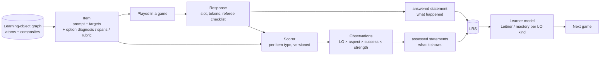

# Learning objects: parts, wholes and evidence

Status: **architecture**, partly decided. Decisions **A1–A3** (below) are
**adopted and built** (2026-10-23). Everything else is the agreed
direction, built when the first feature needs it ([Can wait](#can-wait-no-permanent-footprint)).
It extends the Leitner design in [`leitner-method.md`](./leitner-method.md)
towards grammar, sentences, transfer and critical thinking.

Related:

- `[leitner-method.md](./leitner-method.md)`: tracks, levels, the sense
registry, today's statement tagging (Steps 1–2 built)
- `[../games/game-planning.md](../games/game-planning.md)`: content items,
items, generators, competency levels (`recall` → `recognise` → `apply` →
`transfer`)
- `[LRS.md](./LRS.md)`: statement design, idempotency, permanence of IRIs

---

## Decisions

| # | Date | Decision | Built as |
| --- | --- | --- | --- |
| A1 | 2026-10-23 | **Learning-object identity is language-scoped.** IRI `{base}/lo/{language}/{kind}/{enc(word)}/{sense}`, id `ko/lexeme/시험/test`. Book, chapter and entry are provenance only: `grouping` (`{base}/content/{book}[/chNN]`) and a **book-qualified** `ext/source-ref` (`korean-language-book/ch27/vocabulary/1`). One sense registry per language (`ko-senses.json`), fed by every book. | `learning/learning-object.ts`, `sense-registry.ts`, `book-content.ts`; leitner-method.md L16 |
| A2 | 2026-10-23 | **Evidence is `assessed` statements from day one.** Each tagged guess gives its `answered` statement plus one `assessed` statement per observation, object = the learning object, `context.statement` → the `answered` statement, extensions `aspect`, `role`, `strength`, `source-ref`, `game-kind`, `scorer`. ID = UUID v5 of `gameId:guessId:assessed:<LO IRI>:<aspect>:<scorer>`. The Leitner fold reads **only** `assessed`, and for now only `direct` observations. The verb is ours: `{base}/verbs/assessed`, display "was assessed on" (open question 6 settled). Today's only scorer is `choice-whole@1`. | `learning/observations.ts`, `xapi/statement-builder.ts`, `learning/leitner.ts`; leitner-method.md L17 |
| A3 | 2026-10-23 | **The kind is in the IRI and the activity type.** Built kinds: `lexeme` (type `{base}/activity-types/lexeme-sense`) and `expression` (`{base}/activity-types/expression`). The registry stores the kind per sense; new senses default to `expression` when the word contains a space. Patterns, sentences and competencies get their id shapes when built. | `learning/learning-object.ts`; leitner-method.md L18 |

Checked against Veracity (Strict API Mode) on `emojiapp-dev`, 2026-10-23:
all three statement types accepted and returned unchanged, including the
`StatementRef`; the fold over the returned statements is correct
(leitner-method.md → Step 2b).

---

## The problem

Today one question tests one learning object: `보여 주다` = "to show", for
reading or writing. The answer is right or wrong, and one track moves.

That won't hold as the content grows:

1. **A whole made of parts.** `보여 주다` is one learning object, taught as
  one entry in one source (ch. 27, entry 5). It's also made of parts that
   are learning objects in their own right: the verb `보이다` (to be seen,
   to show) conjugated to `보여`, and `주다` (to give), which here acts as an
   auxiliary, "do something for someone" (`-아/어 주다`).
2. **Partly right answers.** A student who builds `보 주다` has got the
  `주다` part right and the `보여` part wrong. Marking the whole thing
   wrong throws away real evidence. Marking it right would be false.
3. **Grammar.** A cloze question (`너무 오래 ___ 어지러워요` → `달렸더니`)
  tests a grammar pattern (`-았/었더니`) and a verb (`달리다`) at once.
4. **Sentences, transfer, critical thinking.** "Tell the doctor two
  symptoms using `-았/었더니`" (`game-planning.md` → `roleplay.performance`)
   produces evidence about several words, a pattern and a competency
   ("can describe symptoms"). A referee checklist judges it, not a single
   right answer.

So the question to answer is this: how does one response become evidence
about several learning objects, each moving only its own track?

---


## Recommendation in one paragraph

Separate **what happened** from **what it shows**. Learning objects form
a **graph**: atoms (word senses, grammar patterns) and composites
(phrases, sentences, competencies) linked by `partOf` relations. Each
**item** declares which learning objects it **targets** (a *Q-matrix* row)
and, where possible, how a response maps onto them: diagnostic options
for multiple choice, spans for built or typed answers, rubric criteria for
referee-judged tasks. A per-item-type **scorer** turns one response into
**observations**: `(learning object, aspect, success, strength)`. It only
records an observation when the response genuinely shows something about
that learning object. In xAPI, the response stays one `answered`
statement, and each observation becomes its own `assessed` statement
about the learning object itself. The learner model (Leitner today, other
strategies for competencies later) folds **observations only**, per
track. Every future feature then plugs into one pipeline: item → scorer →
observations → statements → fold.

This is the standard shape of **evidence-centred design** (ECD; Mislevy
et al.), used in large-scale assessment. Its *task model*, *evidence
model* and *student model* map onto items, scorers and tracks here.

---


## The pipeline




| ECD term       | Here                                                      | Today's equivalent                   |
| -------------- | --------------------------------------------------------- | ------------------------------------ |
| Student model  | Tracks: `(student, learning object, aspect)` with a state | `TrackState` (`learning/leitner.ts`) |
| Task model     | Item + its targets                                        | A question with one `learning` tag   |
| Evidence model | Scorer + attribution rules → observations                 | `result.success` on one statement    |


---


## 1. The learning-object graph


### Kinds


| Kind              | Examples                                          | Usually atomic?              | Taught from                                            |
| ----------------- | ------------------------------------------------- | ---------------------------- | ------------------------------------------------------ |
| `lexeme-sense`    | `보이다/to-show`, `주다/to-give`, `배/pear`             | Yes                          | Vocabulary lists                                       |
| `expression`      | `보여 주다/to-show`, `장 보러 가다/to-go-grocery-shopping` | No: lexemes + patterns       | Vocabulary lists (multi-word entries)                  |
| `grammar-pattern` | `-아/어 주다` (do for someone), `-았/었더니`              | Yes                          | Chapter `patterns`                                     |
| `sentence`        | `너무 많이 먹었더니 배 아파요`                                | No                           | Dialog lines, sample sentences, exercises              |
| `competency`      | "Can describe cold and flu symptoms to a doctor"  | No: evidence from many items | Curriculum / teacher (`game-planning.md` → Competency) |


Kinds are an open list, like aspects. The architecture only assumes that
learning objects have a kind, an identity and optional parts.

### Composition: `partOf` with spans

A composite records its parts, with the **span** of the surface form each
part covers. Spans are what let a scorer say which part a response got
right.

```yaml
id: ko/expression/보여 주다/to-show
surface: 보여 주다
parts:
  - lo: ko/lexeme/보이다/to-show       # 보이 + -어 → 보여
    span: [0, 2]                        # "보여"
    role: head
  - lo: ko/pattern/a-eo-juda            # -아/어 주다: do something for someone
    span: [1, 5]                        # "여 주다" (the -어 ending + 주다)
    role: grammar
  - lo: ko/lexeme/주다/to-give
    span: [3, 5]                        # "주다"
    role: auxiliary
```

How fine-grained the analysis goes (is `주다` here the lexeme, or only part
of the `-아/어 주다` pattern?) is a **content decision**, not an
architectural one. The graph supports both readings, and a part can sit
inside overlapping spans. Your `보 주다` example works under either: the
`주다` span is right, and the `보여` span is wrong.

Other relations from `game-planning.md` stay: `exampleOf` (sentence →
pattern), `confusableWith` (distractor choice), `usedIn`. Add
`prerequisite` later if the planner should hold back a composite until its
parts reach a level.

### Identity versus provenance

Until A1, a learning object's IRI was **book-scoped**:
`…/content/korean-language-book/vocabulary/보여 주다/to-show`. That's fine
for one book, but it's the wrong scope for parts:

- `주다` learned in this book and in a second book is the same knowledge
in the student's head. Two IRIs would split its evidence into two
tracks.
- Parts often have **no source entry at all**. `보이다` may never appear
in a vocabulary list, yet it's evidenced every time `보여 주다` is
built correctly.

**Decided (A1):** identity is **language-scoped**, and the book, chapter
and entry are **provenance** (which the statements already carry as
grouping and `source-ref`):

```
{base}/lo/ko/lexeme/{enc(word)}/{sense}
{base}/lo/ko/expression/{enc(phrase)}/{sense}
{base}/lo/ko/pattern/{slug}
{base}/lo/competency/{framework}/{code}
```

The book-scoped vocabulary IRIs became `expression` and `lexeme` IRIs
(no pilot statements used the old ones). The book keeps its role as a grouping activity, so
filtering the progress query by book still works. Senses stay
disambiguated by the registry, which becomes a **language-level** registry
fed by every book.

This was the one identity decision worth making **before** pilot
statements exist. See [Decisions](#decisions).

### Taught and implied learning objects

- **Taught**: the student met it as a source entry (vocabulary, pattern, `dialog). The planner may schedule it.
- **Implied**: it only gets evidence as a part of something taught
(`보이다` inside `보여 주다`). Its track accumulates evidence, but the
planner **doesn't schedule it** until a source teaches it. At that point
the student may already be at L1 or L2, which is correct.

---


## 2. Items declare their targets (the Q-matrix)

An item lists what it tests. This generalises today's single
`Question.learning` tag to a list:

```ts
type ItemTarget = {
  lo: string;             // learning-object id
  aspect: string;         // reading, writing, listening, speaking, …
  role: 'whole' | 'part'; // the thing asked for, or a component of it
  span?: [number, number];// on the expected answer, for constructed responses
};
```

How each response type supports attribution:


| Response type                             | Hardware today? | What it can attribute                           | How                                                      |
| ----------------------------------------- | --------------- | ----------------------------------------------- | -------------------------------------------------------- |
| Multiple choice (cards A–D)               | ✅               | Whole; **parts too, if options are diagnostic** | Each option records which targets it gets right or wrong |
| Sequencing (syllable/word cards, Phase 4) | Phase 4         | Parts                                           | Align the built tokens with the expected spans           |
| Typed/free text                           | Later           | Parts                                           | Same alignment, plus normalisation (spacing, jamo)       |
| Referee-judged (speaking, role-play)      | Phase 2         | Rubric criteria → parts or competencies         | Each checklist step names its target(s)                  |
| Self-rating (confidence)                  | ✅ (A–D = 0–3)   | Whole, rated not scored                         | `leitner-method.md` → Confidence                         |


### Diagnostic options: part-level evidence on today's hardware

Multiple choice can already produce part-level evidence, provided each
distractor is **wrong in a known place**. Today's `writingItem` already
builds distractors by changing **one syllable** of the answer, so the
generator knows exactly which span each distractor breaks. It only has to
record it.

Writing question, prompt "to show", targets: `expression 보여 주다`
(whole), `lexeme 보이다` (span "보여"), `lexeme 주다` (span "주다"):


| Option | Text  | Whole | 보이다 | 주다  |
| ------ | ----- | ----- | --- | --- |
| A      | 보여 주다 | ✓     | ✓   | ✓   |
| B      | 보여 추다 | ✗     | ✓   | ✗   |
| C      | 보혀 주다 | ✗     | ✗   | ✓   |
| D      | 보 주다  | ✗     | ✗   | ✓   |


A student who picks **B** gives evidence that they know `보여` but not
`주다`. Picking **C** or **D** shows the reverse.

Two caveats are built into the attribution rules below:

- Picking the right answer is weak evidence about the parts, because the
student recognised a whole.
- Picking a distractor shows its "correct" parts only weakly, because the
student may simply have missed the error.

**Reading questions** (Korean → meaning) usually attribute to the whole
only. The meaning of `보여 주다` isn't "made of" the meaning of its
parts in a way a choice can isolate.

---


## 3. Scoring and attribution

A **scorer** is a pure, versioned function per item type:

```ts
type Observation = {
  lo: string;
  aspect: string;
  success: boolean;
  /** direct: the item asked for this; indirect: inferred as a part. */
  strength: 'direct' | 'indirect';
  /** Optional partial credit for the whole, e.g. 0.5 for one part of two. */
  scaled?: number;
};

score(item: Item, response: Response): { observations: Observation[]; scorer: string /* 'choice-diagnostic@1' */ };
```


### Attribution rules (proposed defaults)


| Situation                                                        | Whole         | Parts                                                                                             |
| ---------------------------------------------------------------- | ------------- | ------------------------------------------------------------------------------------------------- |
| Correct whole                                                    | ✓ direct      | ✓ **indirect** (they used the part correctly)                                                     |
| Wrong, diagnosable (distractor or alignment pins the error)      | ✗ direct      | ✗ direct on the broken part, ✓ indirect on the intact parts                                       |
| Wrong, not diagnosable (reading, or a scrambled answer)          | ✗ direct      | **No observation.** Don't blame parts you can't attribute.                                        |
| Ambiguous span (`보` for `보여`: wrong verb, or wrong conjugation?) | ✗ direct      | ✗ on the **narrowest** target that covers the error, if the scorer can justify it; otherwise none |
| Referee rubric                                                   | Per criterion | Each criterion names its targets: met → ✓, not met → ✗                                            |


Your `보 주다` example, as a sequencing or typed response:


| Target                           | Span   | Expected | Got  | Observation                                                                                                                                                                                                              |
| -------------------------------- | ------ | -------- | ---- | ------------------------------------------------------------------------------------------------------------------------------------------------------------------------------------------------------------------------ |
| `expression 보여 주다`               | whole  | 보여 주다    | 보 주다 | ✗ direct, `scaled` 0.5                                                                                                                                                                                                   |
| `lexeme 주다`                      | [3, 5] | 주다       | 주다   | **✓ indirect**                                                                                                                                                                                                           |
| `lexeme 보이다` / `pattern -아/어 주다` | [0, 2] | 보여       | 보    | ✗ on the narrowest justified target. `보` is the stem of `보다`, so the likely error is the conjugation, i.e. `보이다`. A rule decides this, and the rule is pedagogy, so it lives in the scorer, is tested, and is versioned. |


### Strength matters to the learner model

Indirect evidence is real but weaker. The proposed Leitner policy (all
config, recomputable later):

- **Direct** observations follow today's rules exactly.
- **Indirect successes** update the counts and `lastSeenAt`, and **can
promote only when due**, as now. They **can't promote above L2 and
can't retire** a track. Retirement needs a direct pass at L3, so a word
is never retired because it was part of something.
- **Indirect failures** demote like direct ones. A pinned error is a
pinned error.

---


## 4. Evidence in xAPI: `answered` plus `assessed`

**What happened** stays one `answered` statement per guess, exactly as
today. It describes the item (question activity, choices, response,
duration), and its `grouping` lists every target learning object, so
"every attempt involving `주다`" is one LRS query.

**What it shows** is one `assessed` statement per observation, about
the learning object itself:

```json
{
  "id": "<uuid v5 of gameId:guessId:assessed:<lo>:<aspect>:<scorer>>",
  "actor": { "…": "same student" },
  "verb": { "id": "https://kogs.link/xapi/emoji-app/verbs/assessed", "display": { "en-US": "was assessed on" } },
  "object": {
    "objectType": "Activity",
    "id": "https://kogs.link/xapi/emoji-app/lo/ko/lexeme/%EC%A3%BC%EB%8B%A4/to-give",
    "definition": { "type": "https://kogs.link/xapi/emoji-app/activity-types/lexeme-sense", "name": { "ko": "주다", "en-US": "to give" } }
  },
  "result": { "success": true },
  "timestamp": "<same as the guess>",
  "context": {
    "registration": "<game registration>",
    "statement": { "objectType": "StatementRef", "id": "<the answered statement id>" },
    "contextActivities": {
      "parent": [{ "id": "…/games/{gameId}/questions/{questionId}" }],
      "grouping": [{ "id": "…/content/korean-language-book/ch27" }, { "id": "…/content/korean-language-book" }]
    },
    "extensions": {
      "…/ext/aspect": "writing",
      "…/ext/role": "part",
      "…/ext/strength": "indirect",
      "…/ext/whole": "…/lo/ko/expression/…/to-show",
      "…/ext/source-ref": "ch27/vocabulary/5",
      "…/ext/game-kind": "leitner-solo",
      "…/ext/scorer": "sequence-align@1"
    }
  }
}
```

Why separate statements, and not extensions on `answered`:

- **The LRS sees learning objects natively.** Veracity's "Low Scoring
Objects" widget, activity reports and `activity=` queries work per
learning object, with no custom code. That's Q4 from `LRS.md`, done
properly.
- **One evidence path.** The fold reads `assessed` statements only, and
never has to understand item types. A new item type means a new scorer,
not a new fold.
- **Auditable.** `context.statement` links each observation to the
response that produced it.
- **No double counting.** Q1–Q6 reports built on `answered` are unchanged,
because `assessed` is a different verb.


### Re-scoring

Statements are permanent, but scorers will improve. The `answered`
statement is **self-describing**: it holds the response, the targets with
their spans or diagnosis, and the scorer version, so evidence can always
be re-derived. To change history, **void** the old `assessed` statements
(standard xAPI voiding) and send new ones. The scorer version is part of
the ID seed, so the new ones get new IDs and no 409. This should be rare,
and it's an admin script, not a game feature.

Volume: a sentence item might produce 4–6 `assessed` statements per guess.
At pilot scale (`LRS.md` → Volume and sizing), that's still well inside
Veracity's free tier.

---


## 5. The learner model per kind

Tracks stay `(student, learning object, aspect)`, and the fold stays a
pure function of observations. What changes is that **each kind of
learning object can use its own strategy**:


| Kind                         | Strategy                                                                                                                        | Why                                               |
| ---------------------------- | ------------------------------------------------------------------------------------------------------------------------------- | ------------------------------------------------- |
| `lexeme-sense`, `expression` | Leitner 0–3, then retired (today's rules), plus the strength policy above                                                       | Recall decays, and spaced review fits             |
| `grammar-pattern`            | Leitner, but promotion needs success **in different sentences** (different `whole`s)                                            | Recognising one example isn't knowing the pattern |
| `sentence`                   | Usually **not scheduled**: its parts are. Track it only if the sentence itself is the goal (a memorised dialog line).           | Sentences are the vehicle, not the target         |
| `competency`                 | **Evidence accumulation**: N direct successes across ≥ M distinct contexts and levels (`apply`, `transfer`). No decay schedule. | Competencies are shown, not drilled               |


`game-planning.md`'s `recall` → `recognise` → `apply` → `transfer` levels
then become a property of **items and observations**: "this success was
at `transfer` level". The competency strategy is a different fold over the
same observations.

---


## 6. Grammar, transfer and critical thinking

The pipeline needs nothing new for these, just new learning-object kinds,
item types and scorers:

- **Grammar (cloze, ordering):** targets = the pattern (direct) plus the
words in the blank (indirect). Diagnostic options: `달렸더니` ✓,
`달려서` (right verb, wrong pattern), `먹었더니` (right pattern, wrong
verb).
- **Transfer (new sentence, new context):** the item's level is
`transfer`. Observations on the pattern and the competency carry
`…/ext/level: transfer`, and the competency strategy counts distinct
contexts.
- **Critical thinking / open tasks:** the referee rubric (Phase 2's
generalised `Guess`, `source: 'referee'`). Each checklist step targets
one or more learning objects or competencies and produces direct
observations. "Used `-았/었더니` correctly" → pattern ✓; "gave two
symptoms" → competency ✓.

---


## 7. Authoring decompositions

The source data has no decompositions. Options, from cheapest to richest:


| Option                                                                                                  | Quality                                    | Effort                    | Fit                                        |
| ------------------------------------------------------------------------------------------------------- | ------------------------------------------ | ------------------------- | ------------------------------------------ |
| Hand-authored parts map in the registry                                                                 | High                                       | High per word             | Pilot: a handful of multi-word expressions |
| **AI-suggested (Hashbrown), human-confirmed** in the registry, like the sense registry's "stop and ask" | Good                                       | Low                       | **Recommended** default                    |
| Korean morphological analyser (e.g. Kiwi, MeCab-ko) suggesting stems and endings                        | Good for morphology; doesn't know pedagogy | Medium (a new dependency) | Later, to pre-fill AI suggestions          |


Either way, decompositions are **committed data** with stable IDs, never
computed at play time. That's the same rule the sense registry follows,
for the same reason.

---


## Impact on the current Leitner work

Leitner games are **deleted after export** (L10), so the stored `Question`
shape can change freely: nothing long-lived depends on it. **Only the
statement shape and the IRIs are permanent.** That decides what's worth
doing before the pilot starts and what can wait.

### Decided before pilot statements exist (done)


| #   | Proposal                                                                                                                                                                                 | Cost now                                                                                                              | Cost later                                                                                                          |
| --- | ---------------------------------------------------------------------------------------------------------------------------------------------------------------------------------------- | --------------------------------------------------------------------------------------------------------------------- | ------------------------------------------------------------------------------------------------------------------- |
| A1  | **Language-scoped learning-object IRIs** (`…/lo/ko/expression/…`), with book, chapter and entry as provenance only (they already are, as grouping and `source-ref`)                      | Small: change `learningObjectIri`, the fold's parser, and move the sense registry to language level                   | Every pilot statement keeps the book-scoped IRI forever, and the same word from two books splits into two tracks    |
| A2  | **Emit** `assessed` **statements from day one**, even for today's single-target questions (one `assessed` per guess, `role: whole`, `strength: direct`). The fold reads `assessed` only. | Medium: the builder adds one statement per tagged guess, and the fold switches verb. The Step 1 smoke test is re-run. | Two evidence paths in the fold forever (tagged `answered` from the pilot, `assessed` after), or a voiding migration |
| A3  | Learning-object **kind** in the IRI and activity type (`lexeme-sense`, `expression`)                                                                                                     | Trivial, alongside A1                                                                                                 | Re-typing activities later is messy                                                                                 |


**Adopted 2026-10-23 and built before the first pilot game** (see
[Decisions](#decisions)). The smoke-test statements in `emojiapp-dev`
should be cleared before the pilot.

### Can wait (no permanent footprint)


| Change                                                                         | When                                                     |
| ------------------------------------------------------------------------------ | -------------------------------------------------------- |
| `Question.learning` → `targets[]` with spans and option diagnosis              | When the first multi-target item type is built           |
| Diagnostic `writingItem` (record which span each distractor breaks)            | Same time. The generator already changes one syllable.   |
| Strength policy in `LeitnerConfig` (indirect can't promote above L2 or retire) | With the first `indirect` observation                    |
| `partOf` decompositions in the registry, and the AI-suggest workflow           | When multi-word expressions are first scheduled as parts |
| Per-kind learner-model strategies (pattern contexts, competency accumulation)  | With grammar and competency items                        |
| Scorer registry, versioning, re-scoring script                                 | With the second scorer                                   |


---


## Risks and trade-offs

- **Over-attribution.** Crediting parts too generously inflates levels.
Mitigated by the strength policy (indirect can't retire) and by "no
observation when not diagnosable". Watch pilot data before relaxing it.
- **Decomposition quality.** Bad part maps produce confident nonsense.
They're reviewed data, the same as senses, and re-scoring can fix
history.
- **Statement volume.** There are several `assessed` statements per
guess. That's fine at pilot and class scale, but revisit caching (`since=`
  - snapshot, `leitner-method.md`) when a learner reaches thousands.
- **Pedagogy hidden in code.** Attribution rules *are* pedagogy. Keep them
in small, named, tested scorer functions with versions, and document
them in plain language so a teacher can review them.
- **Custom verb.** `…/verbs/assessed` is ours, so other LRS tools won't
know it. ADL `passed`/`failed` were considered, but they mean
"completed an assessment" and would muddy completion reports. Keeping
our own verb, documented, is the honest choice.

---


## Open questions

1. **Granularity of** `보여 주다`: lexeme `보이다` + lexeme `주다`, or
  `보이다` + pattern `-아/어 주다`, or all three? This is a content
   decision. The architecture supports any of them.
2. ~~**A1–A3 now?**~~ Yes: adopted and built 2026-10-23.
3. **Do indirect observations ever retire a part?** Proposed: never.
  Retirement needs a direct pass at L3.
4. **Should a composite wait for its parts?** For example, don't schedule
  `보여 주다` writing until `주다` writing is L1+ (`prerequisite`
   relations). This is a planner policy, and it can come later.
5. **Who reviews decompositions?** Same open question as the sense
  registry in `leitner-method.md`.
6. ~~**Verb name.**~~ `…/verbs/assessed` ("was assessed on"), adopted
  with A2. It's permanent now that the builder emits it.


## References

- R. J. Mislevy, R. G. Almond, J. F. Lukas, *A Brief Introduction to
Evidence-Centered Design* (ETS, 2003): student, evidence and task models.
- K. K. Tatsuoka, Q-matrix and rule-space methods: mapping items to the
skills they require, which `targets[]` is.
- xAPI 1.0.3: `context.statement` (StatementRef), voiding, context
activities.

